# D+DZ+PRS 解説: 差分符号化 + dead-zone 量子化 + NACK による参照フレーム選択

このドキュメントでは、パケットロス実験（[experiments.md のレシピ 5](experiments.md)）で使う方式
**D+DZ+PRS** について、何をしているのか・なぜ効くのか・どこに実装されているのか・どう使うのかを、図を中心に順に説明します。

- 実装: `src/splitcomp/temporal/coding.py`（`TemporalEncoder` / `TemporalDecoder`）、`scripts/packet_loss_sweep.py`（`prs_clip`）
- 設定: `configs/packet_loss_ucf101.yaml` の `D+DZ+PRS`（フィードバック遅延 d = 1）と `D+DZ+PRS3`（d = 3）
- 元になった論文: H. Shiba et al., "Delta Coding With Dead-Zone Quantization for Bandwidth-Efficient Split Computing on Video Streams," IEEE Access, vol. 14, 2026（D+DZ まで。PRS はこの基盤で追加したもの）

> 図は [Mermaid](https://mermaid.js.org/) で書いています。GitHub や VS Code（Markdown Preview Mermaid Support などの拡張）でそのまま表示されます。
>
> 図の色の意味（全章共通）:
> 🟩 緑 = クラウドで正しく復元できたフレーム / 🟥 赤 = パケットが落ちたフレーム / 🟧 橙 = ロスの影響でずれたフレーム / 🟦 青 = I フレーム

---

## 目次

1. [ひとことで言うと](#1-ひとことで言うと)
2. [前提: 動画のスプリットコンピューティング](#2-前提-動画のスプリットコンピューティング)
3. [D: 差分符号化（DPCM）](#3-d-差分符号化dpcm)
4. [DZ: dead-zone 量子化](#4-dz-dead-zone-量子化)
5. [パケットロスで D+DZ に起きること](#5-パケットロスで-ddz-に起きること)
6. [PRS: 壊れたフレームを避けて参照する](#6-prs-壊れたフレームを避けて参照する)
7. [具体例でたどる](#7-具体例でたどる)
8. [コストと性質](#8-コストと性質)
9. [ほかのロス対策との比較](#9-ほかのロス対策との比較)
10. [実装の対応関係](#10-実装の対応関係)
11. [使い方](#11-使い方)
12. [結果の見方と実測例](#12-結果の見方と実測例)
13. [前提・制限](#13-前提制限)
14. [よくある疑問](#14-よくある疑問)

---

## 1. ひとことで言うと


| 記号 | 意味 | 役割 |
|---|---|---|
| **D** | Delta coding（DPCM） | 「前のフレームとの差」だけを送って、送信量を減らす |
| **DZ** | Dead-Zone 量子化 | 0 付近の小さな差をまとめて 0 にし、さらに送信量を減らす |
| **PRS** | NACK による参照フレーム選択 | ロスが起きたら、クラウドが「壊れたフレームの番号」だけを返し、端末は以後**壊れていないフレームとの差**を送る。ロスの伝搬を数フレームで止める |

D+DZ は帯域を節約できる反面、**1 回のパケットロスが GoP（次の I フレーム）の終わりまで尾を引く**という弱点があります。
PRS はこの弱点を、ごく小さなフィードバック（壊れたフレームの番号だけ）で解消します。
**ロスがなければ D+DZ と完全に同じ符号化・同じ結果**になるのも特徴です。

> 名前について: 動画符号化（H.263 Annex N など）では一般に RPS（Reference Picture Selection）と呼ばれる手法です。
> この基盤では設定名・列名に合わせて **PRS** と書きます。

---

## 2. 前提: 動画のスプリットコンピューティング

### システム全体図

Shiba et al. の FIGURE 1（D+DZ のシステム全体図）と同じ構成・配色で描き、PRS で加わる部分を書き足した図です
（`docs/images/d_dz_prs_system.svg`）。

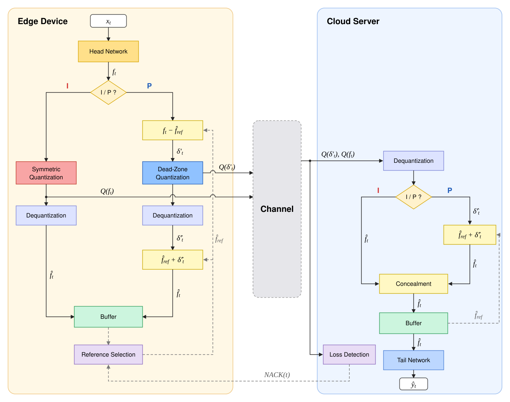

論文の FIGURE 1 から変えたところ:
- **Reference Selection**（端末、薄紫）: Buffer の中から、クラウドで壊れていない最新のフレームを参照 f̂_ref に選ぶ。
  無ければそのフレームを I フレームにする（強制 I）。論文では参照は常に直前の f̂_{t−1}
- **Loss Detection**（クラウド、薄紫）: パケットが 1 つでも欠けたフレームの番号 t を **NACK(t)** として端末に返す（d フレーム後に届く）
- **Concealment**（クラウド）: 欠けた要素を参照フレームの値で補う（hold）。論文はロスのない通信路を想定しているので無い
- **Buffer**: 参照が直前とは限らないので、端末・クラウドとも GoP 内の f̂ を全て残す。参照先 ref はパケットヘッダで送る

- DNN を分割点で head / tail に分け、head の出力（中間特徴 f_t。例: ResNet50 layer2 なら 512×28×28）を送る
- 動画では隣り合うフレームの特徴がよく似ている（論文 Table 7 では相関 ρ が 0.91〜0.98）。この**時間方向の冗長性**を使うのが D
- 評価指標は主に `agreement`（量子化・ロスなしの元モデルとの top-1 一致率）と `bytes_per_frame`（1 フレームの送信量）

---

## 3. D: 差分符号化（DPCM）

### GoP 構造

フレームを GoP（既定 30 フレーム）ごとに区切り、先頭を **I フレーム**、残りを **P フレーム**にします。
矢印は「参照される → 参照する」の向きです。

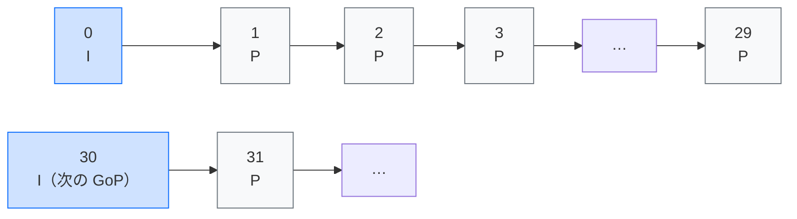

- **I フレーム**: 特徴 f_t そのものを量子化して送る（単独で復号できる）
- **P フレーム**: 参照フレームとの差を量子化して送る（参照フレームが無いと復号できない）

### 何の差を送るか（3 方式の違い）

| 方式 | P フレームで送るもの | 性質 |
|---|---|---|
| `fd`（F+Sym） | 差分を使わず毎フレーム I | ロスが伝搬しないが、送信量が多い（ベースライン） |
| `dwd` | 真の差分 δ_t = f_t − f_{t−1} | クラウド側では量子化誤差が積み重なる（ドリフト） |
| **`dpcm`（D）** | 予測残差 δ'_t = f_t − **f̂**_{t−1} | 端末がクラウドと同じ復元値 f̂ を計算して差をとるので、ドリフトしない |

### DPCM の仕組み: 端末が「クラウドの復号器」を内蔵する

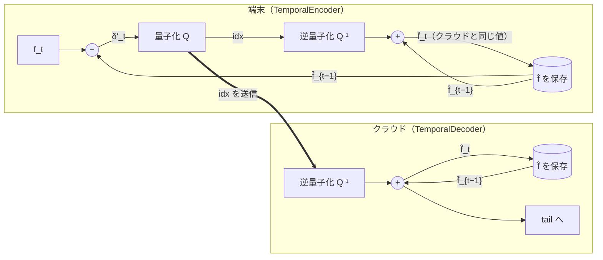

端末とクラウドは同じ計算をしているので、**ロスがなければ両者の f̂ は完全に一致**します。
差 δ'_t は f_t よりずっと小さい値に集中するので、同じビット数でも量子化のステップが細かくなり（範囲 R が小さい）、精度が上がります。

---

## 4. DZ: dead-zone 量子化

量子化は `src/splitcomp/temporal/quantize.py` にあります。

- 範囲 R = |x| の 99 パーセンタイル（P99）。ステップ幅 q = 2R / 2^b（b はビット数）
- **対称量子化（Sym）**: `round(x / q)`。0 になるのは |x| < 0.5q
- **dead-zone 量子化（DZ）**: `sign(x) · floor(|x| / q + 0.25)`。**0 になる範囲を |x| < 0.75q に広げる**（0 のビン幅が 1.5 倍）

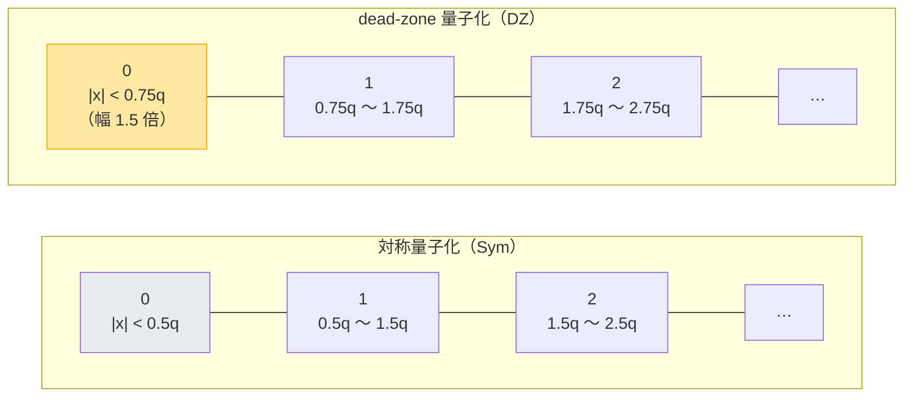

なぜ P フレームで効くのか:

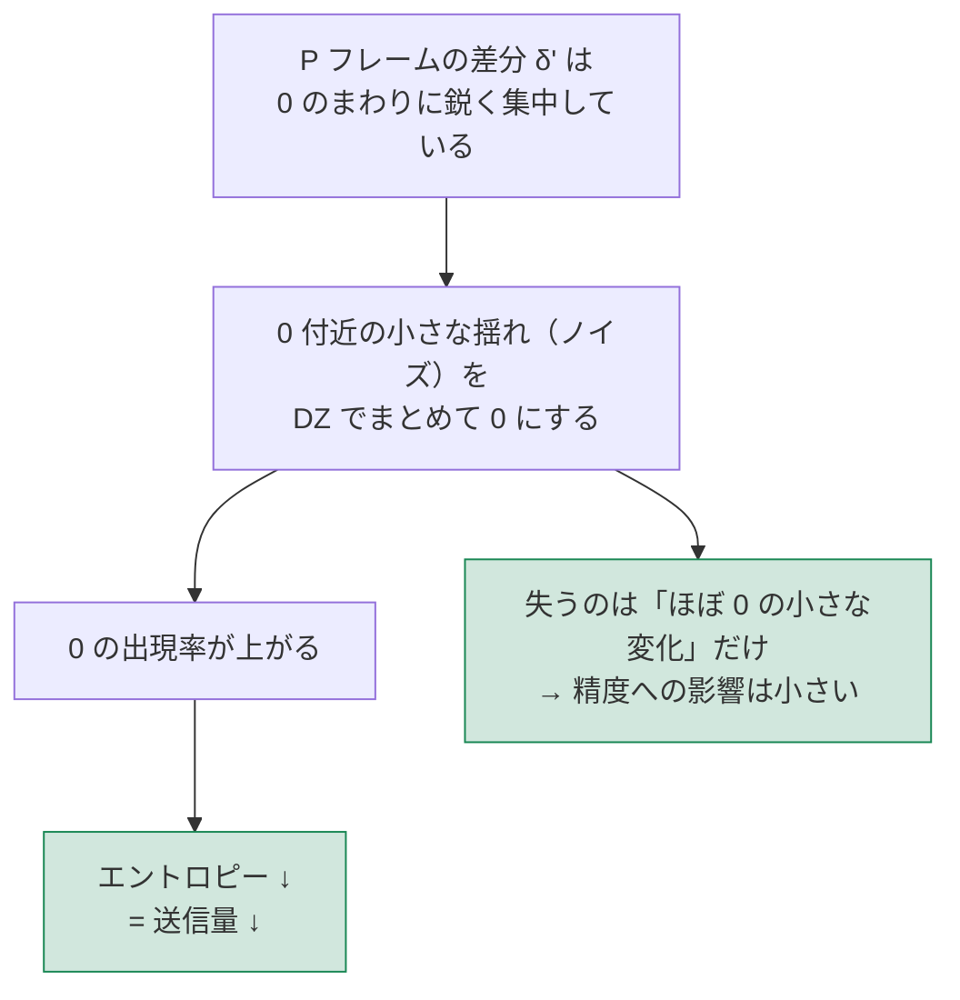

- 一方、I フレーム（特徴そのもの）は 0 付近に集中していないので、DZ にすると精度が大きく落ちる（論文 §III-D: EfficientNetV2-S S3, 2-bit で 0.69 → 0.16）。
  そのため **I フレームは常に対称量子化**で、`p_quant: dz` は P フレームにだけ効く
- 量子化したインデックスは、パケットごとに独立した適応算術符号でエントロピー符号化します（`src/splitcomp/temporal/packet.py`）。
  パケット単体で復号できるので、**ロスしたパケットに入っていた要素だけ**が欠けます

---

## 5. パケットロスで D+DZ に起きること

### ロスしたときの補い方（concealment）

クラウドは、届かなかった要素を `hold`（参照フレームの f̂ の値で埋める = 差 0 とみなす）で補います。

### 問題: ずれが GoP の終わりまで続く

端末はロスを知らないので、ロスがあっても**クラウドが正しく受け取ったつもり**で次の差を計算します。
フレーム 3 でパケットが落ちた場合:

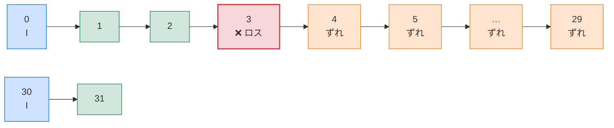

なぜ戻らないのかを、端末とクラウドのやりとりで見ると:

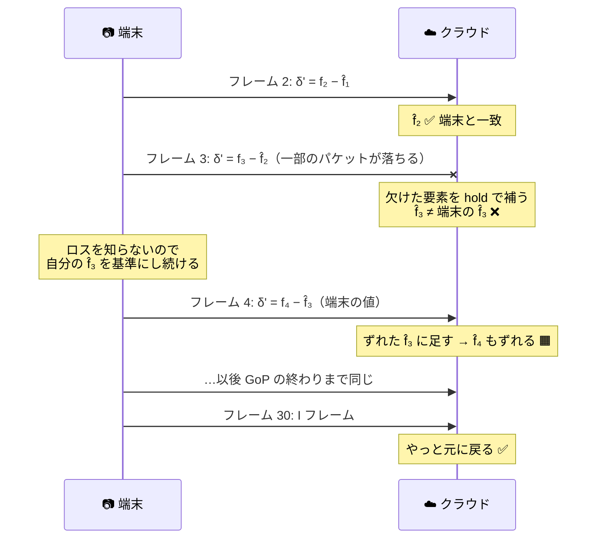

ロスが重なればずれはさらに大きくなります。実測でも、ロス率が上がると D+DZ の一致率は急に下がり、
ロス率が数 % を超えると、毎フレーム I を送る F+Sym よりも悪くなることがあります（[12 章](#12-結果の見方と実測例)）。

---

## 6. PRS: 壊れたフレームを避けて参照する

### アイデア

「ずれ」は、**クラウドで壊れているフレームを、端末が参照に使い続ける**ことで生まれます。
そこで、壊れたフレームを端末に教え、それ以降は壊れていないフレームとの差を送るようにします。

### やりとりの全体像（d = 1 の場合）

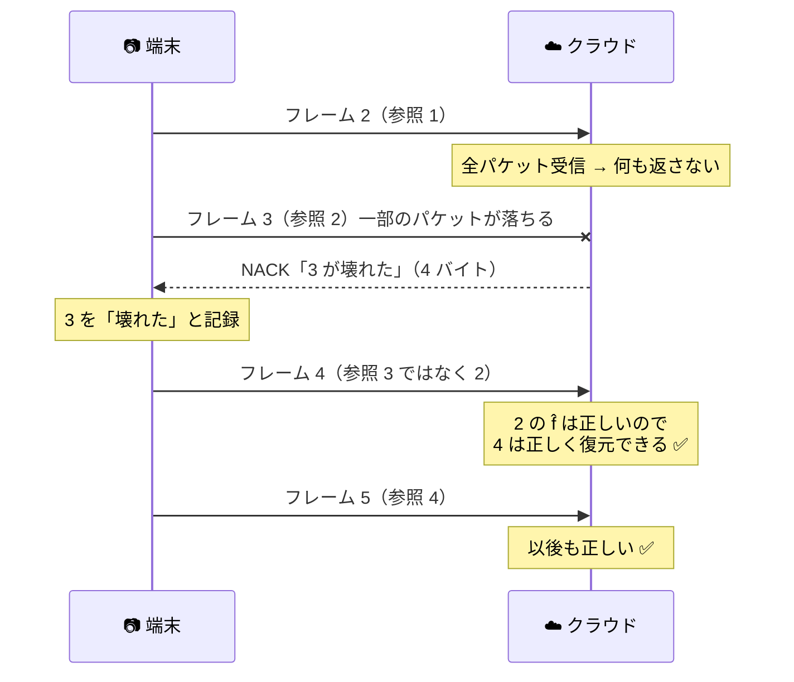

### 手順

1. **クラウド**: フレーム t のパケットが 1 つでも落ちたら、**フレーム番号 t だけ**を NACK として端末に返す。
   届いたフレームには何も返さない（ACK は送らない）
2. **端末**: NACK は `feedback_delay`（d フレーム）後に届く。フレーム t の NACK はフレーム t + d を符号化する前に `enc.nack(t)` で受け取る
3. **端末**: 「クラウドで壊れているフレーム」を判定する（`TemporalEncoder.is_broken`）
4. **端末**: 壊れていないフレームを参照に選ぶ（`TemporalEncoder.select_ref`）
5. **クラウド**: 各フレームのヘッダにある参照先を見て、その f̂ を基準に復号する。
   クラウドは GoP 内の復元済みフレームを保存しているので、古いフレームを参照されても復号できる

### 「壊れている」の判定（`is_broken`）

NACK されたフレームだけでなく、**壊れたフレームを参照した P フレームも壊れている**とみなします。
参照関係は端末自身が決めて記録している（`refs`）ので、参照をたどるだけで判定できます。

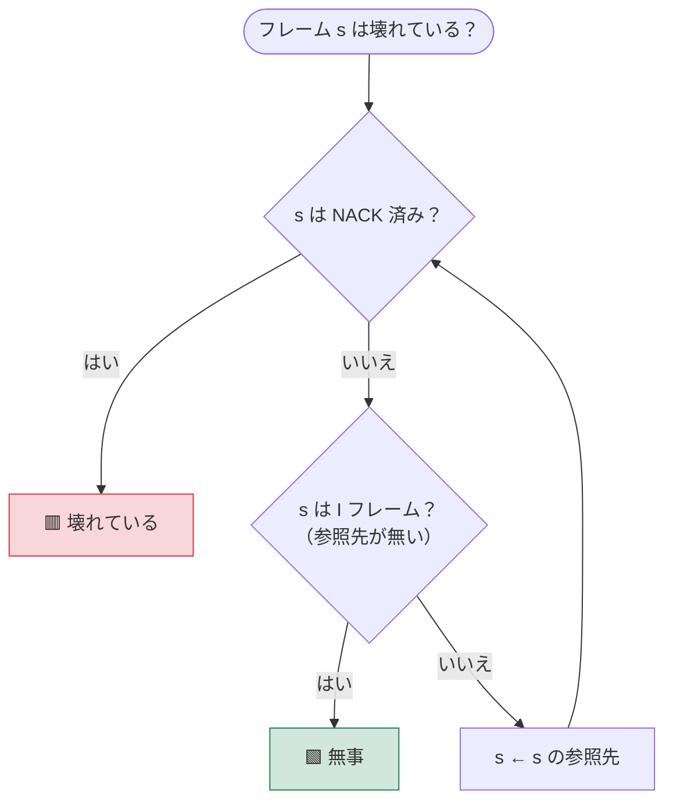

NACK がまだ来ていないフレームは**無事とみなします**（ACK を待たない楽観的な方式）。

### 参照フレームの選び方（`select_ref`）

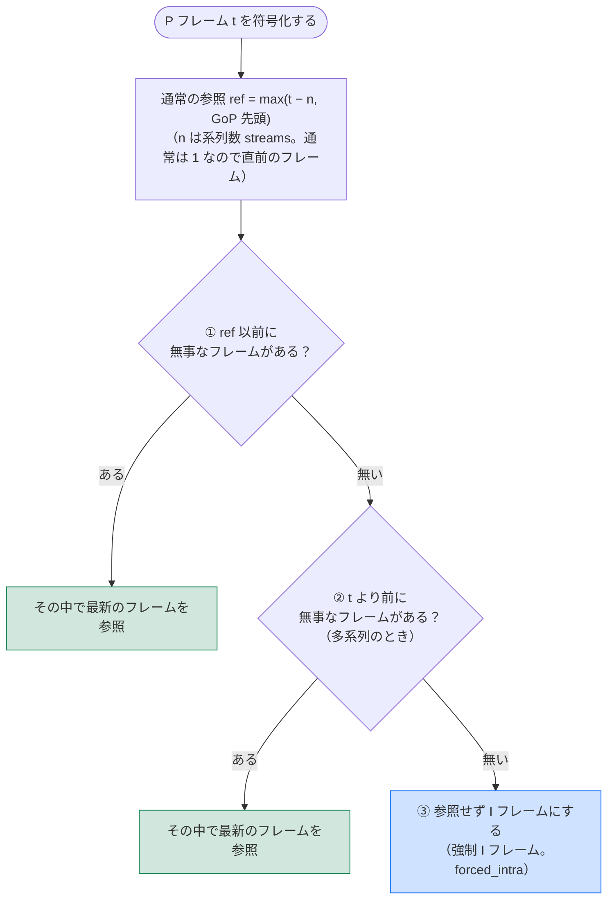

- ③ になるのは、GoP 先頭の I フレームが壊れて GoP 内の全フレームが壊れたときなど
- 参照先は「t − ref」としてパケットヘッダの「種類」u8 の残り 7 ビットに入れる想定です（GoP ≤ 128 なら足りる）。そのため**ヘッダは増えません**

### ポイント

- 端末とクラウドの f̂ が一致している「無事な」フレームだけを参照するので、そこから先はずれが消える
- 伝搬が続くのは「ロスが起きてから NACK が届くまで」の **d フレーム分だけ**
- NACK はロスが起きたときにしか送らないので、フィードバックは極めて少ない

---

## 7. 具体例でたどる

### 例 1: d = 1（NACK が次のフレームまでに届く）

フレーム 3 でロスが起きた場合。4 は 3 を避けて 2 を参照します。

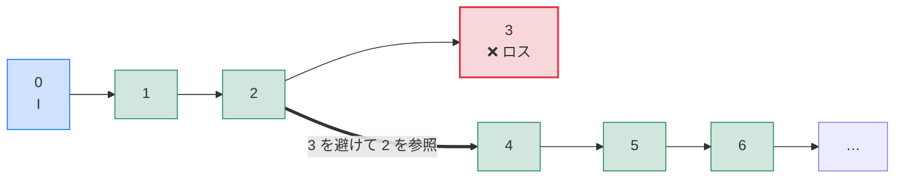

| t | NACK 受信 | 通常の参照 | 実際の参照 | クラウドの状態 |
|---|---|---|---|---|
| 3 | – | 2 | 2 | 🟥 ロスでずれる |
| 4 | 3 | 3（壊れている） | **2** | 🟩 正しい |
| 5 | – | 4 | 4 | 🟩 正しい |

**壊れるのはフレーム 3 の 1 枚だけ**です。

### 例 2: d = 3（NACK が 3 フレーム後に届く）

同じくフレーム 3 でロス。NACK はフレーム 6 の符号化前に届くので、4, 5 は 3 を参照してしまいます。

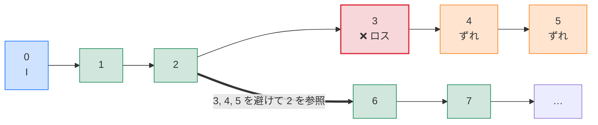

時間の流れで見ると:

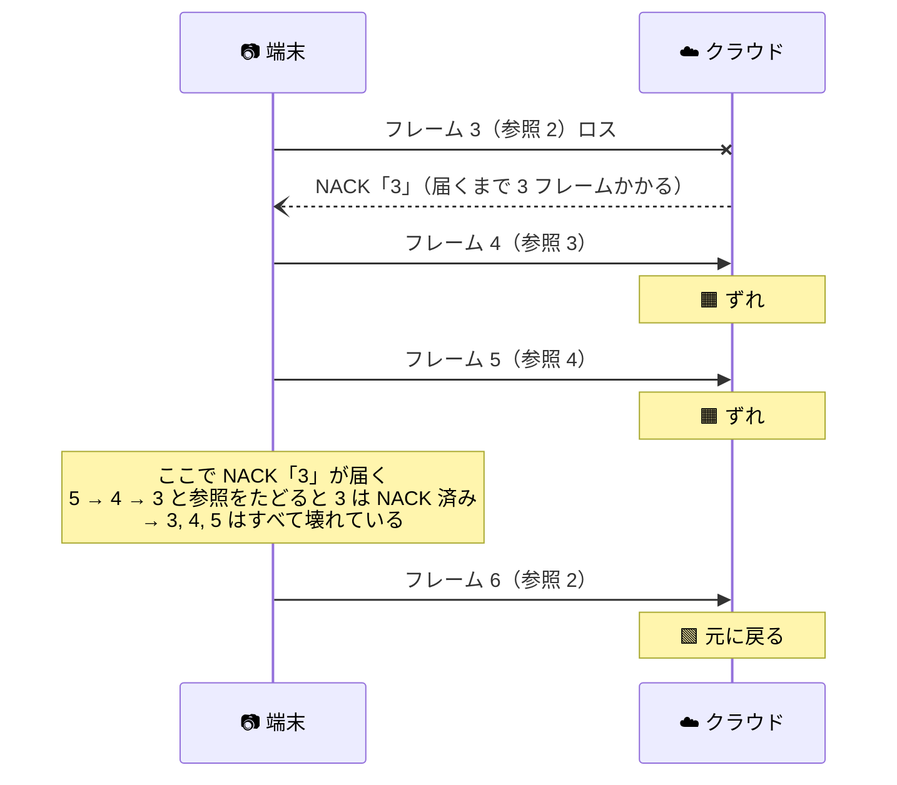

| t | NACK 受信 | 通常の参照 | 実際の参照 | クラウドの状態 |
|---|---|---|---|---|
| 3 | – | 2 | 2 | 🟥 ロスでずれる |
| 4 | – | 3 | 3 | 🟧 3 のずれを引き継ぐ |
| 5 | – | 4 | 4 | 🟧 3 のずれを引き継ぐ |
| 6 | 3 | 5（5→4→3 とたどると NACK 済み） | **2** | 🟩 正しい |

壊れるのは 3, 4, 5 の 3 枚。フレーム 6 は 4 フレーム前の 2 との差になるので、差が大きく送信量が少し増えます。

### d による違いのまとめ

```mermaid
gantt
    title フレーム 3 でロスしたときの、クラウドでずれているフレーム
    dateFormat X
    axisFormat %s
    section D+DZ（対策なし）
    ずれ（GoP の終わりまで）   :crit, 3, 30
    section D+DZ+PRS（d=1）
    ずれ                     :crit, 3, 4
    section D+DZ+PRS3（d=3）
    ずれ                     :crit, 3, 6
```

（横軸はフレーム番号。棒の範囲のフレームがずれている）

### 例 3: 強制 I フレーム

GoP 先頭の I フレーム（フレーム 0）でロスが起きると、GoP 内のフレームはすべて 0 を起点にしているので、NACK を受けると全部が壊れていることになります。
参照できる無事なフレームが無いので、そのフレームを I フレームにして送り直します（d = 1 の例）。

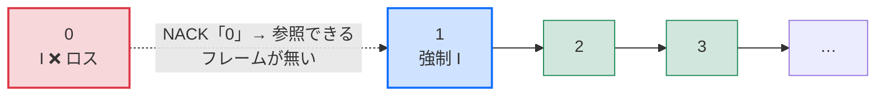

ロス率が高く、ほぼ毎フレームどこかのパケットが落ちる条件でも、無事なフレームが見つからず強制 I フレームが増えます（[12 章](#12-結果の見方と実測例)）。

---

## 8. コストと性質

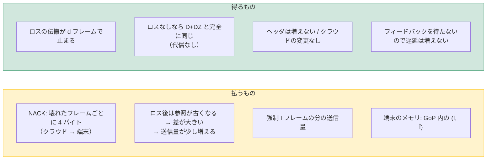

| 項目 | D+DZ+PRS の性質 |
|---|---|
| ロスなし | D+DZ と**完全に同じ**符号化・送信量・精度（代償なし） |
| 端末→クラウドの送信量 | ヘッダは増えない。ロス後は参照が古くなる分、差が大きくなって少し増える。強制 I フレームのぶんも増える |
| クラウド→端末の送信量 | パケットが落ちたフレームごとに NACK 1 つ（フレーム番号 u32 = 4 バイト） |
| ロスの伝搬 | ロスから NACK が届くまでの d フレームで止まる（D+DZ は GoP の終わりまで） |
| 端末の追加の計算 | GoP 内の (f, f̂) を保存しておくメモリ（最大 GoP 枚）。計算量はほぼ同じ |
| クラウドの追加の計算 | なし（復号器は各フレームの `ref` を見るだけ） |
| 遅延 | フィードバックを**待たない**ので、符号化・送信の遅延は増えない |

d と RTT の関係（30fps のとき）: d = 1 なら RTT 33ms 以内、d = 3 なら 100ms 以内で NACK が戻ればよい。

---

## 9. ほかのロス対策との比較

この基盤にある D+DZ のロス対策を、参照の形で並べると次のようになります（フレーム 3 でロスした場合）。

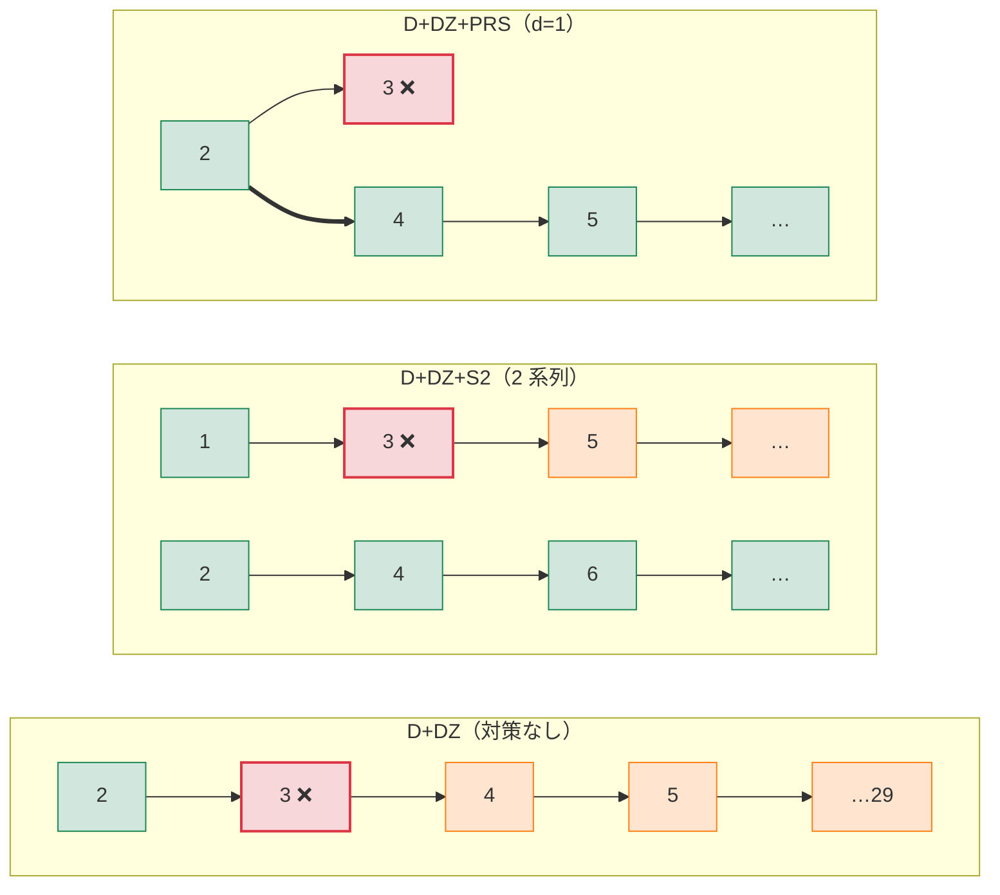

| 方式 | 何をするか | ロスなしの代償 | フィードバック | 伝搬の範囲 |
|---|---|---|---|---|
| D+DZ | 対策なし | – | なし | GoP の終わりまで |
| D+DZ+R | クラウドの小さな CNN で欠けた要素を推定 | なし | なし | 減るが残る |
| D+DZ+S2 / S5 | 参照を n フレーム前にして n 本の独立な系列に分ける | **あり**（差が大きくなり量子化誤差・送信量が増える） | なし | その系列（GoP の 1/n）だけ |
| **D+DZ+PRS / PRS3** | NACK を受けて壊れていないフレームを参照 | **なし** | 壊れたフレームの番号だけ | **d フレーム** |
| F+Sym | 毎フレーム I | 送信量が多い | なし | 伝搬しない |

PRS は `streams`（多系列）や `restorer`（ロス補修 net）とも組み合わせられます（方式の設定に両方書けばよい）。

---

## 10. 実装の対応関係

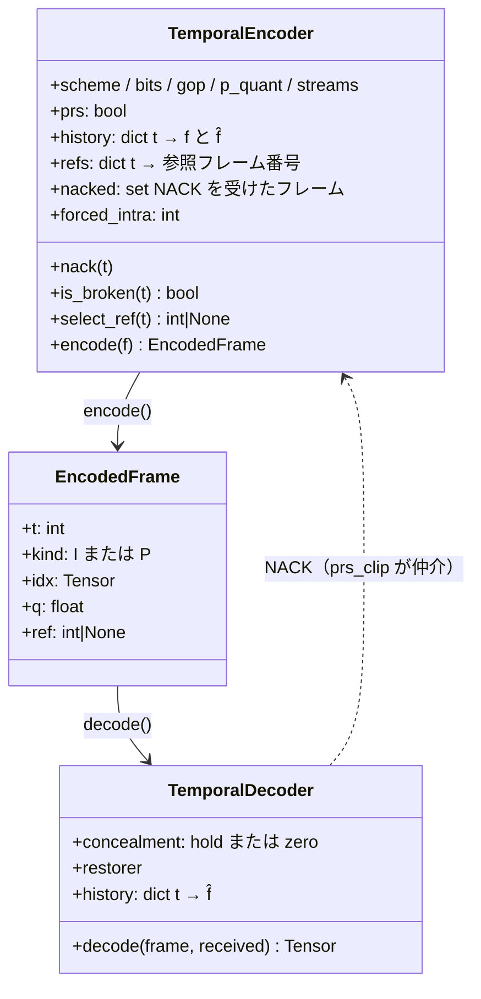

| 内容 | 場所 |
|---|---|
| PRS の有効化、NACK の受け取り | `TemporalEncoder(prs=True)`、`TemporalEncoder.nack(t)`（`src/splitcomp/temporal/coding.py`） |
| 壊れているかの判定（参照をたどる） | `TemporalEncoder.is_broken(t)` |
| 参照フレームの選択（3 段階） | `TemporalEncoder.select_ref(t)` |
| 強制 I フレームの回数 | `TemporalEncoder.forced_intra` |
| 参照先を見て復号 | `TemporalDecoder.decode(frame, received)`（`frame.ref` を使う。PRS 用の変更は不要） |
| dead-zone 量子化 | `deadzone_quantize`（`src/splitcomp/temporal/quantize.py`） |
| 端末とクラウドを 1 フレームずつ交互に動かす閉ループ | `prs_clip`（`scripts/packet_loss_sweep.py`） |

### 端末の状態

- `history`: 現在の GoP のフレーム番号 → (f, f̂)。PRS では古いフレームを参照し直すことがあるので、GoP 内のものは全部残す（PRS なしは直近 `streams` 枚だけ）
- `refs`: 現在の GoP のフレーム番号 → 参照フレーム番号（I フレームは None）。`is_broken` がこれをたどる
- `nacked`: 現在の GoP で NACK を受けたフレーム番号
- GoP の先頭（通常の I フレーム）で 3 つともクリアする。前の GoP のフレームへの NACK は今後の参照に関係しないので無視する

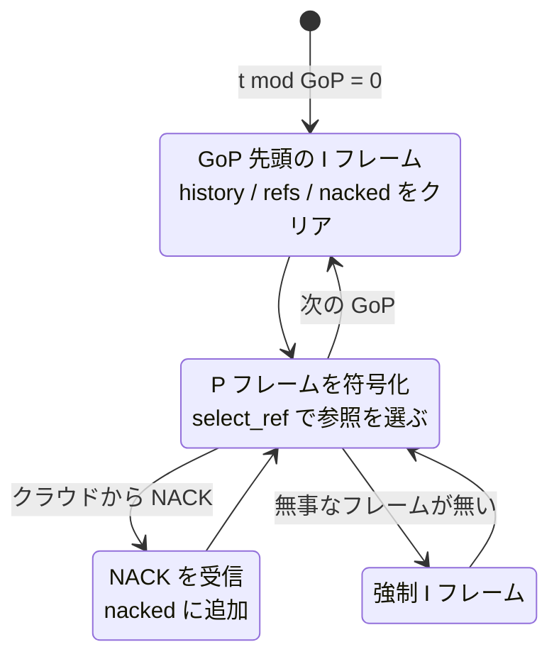

### シミュレーションの閉ループ（`prs_clip` の流れ）

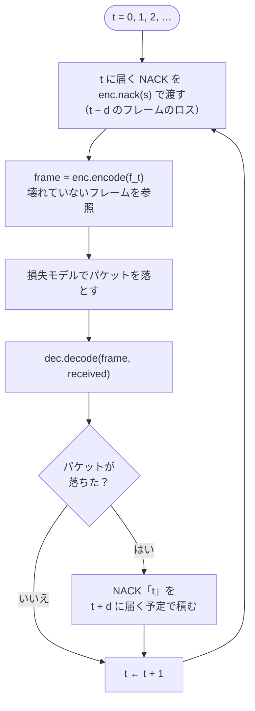

```python
arriving = defaultdict(list)          # 端末に届くフレーム番号 → そのとき届く NACK
for t in range(T):
    for s in arriving.pop(t, []):     # d フレーム前のロスの NACK が届く
        enc.nack(s)
    frame = enc.encode(feats[t])      # 壊れていないフレームを参照して符号化
    lost = loss.drop(num_packets)     # 通信路でパケットを落とす
    recon[t] = dec.decode(frame, received_mask(...))
    if lost.any():
        arriving[t + feedback_delay].append(t)   # クラウドが NACK を返す
```

PRS は端末の符号化がロス（= フィードバック）に依存するので、ほかの方式のように「符号化を 1 回だけして全ての損失条件で使い回す」ことができません。
ただし、今の GoP でまだ NACK を受けていないフレームはフィードバックなしと同じ符号化になるので、そのパケット分割を使い回して高速化しています（結果は完全に一致）。

---

## 11. 使い方

### 設定ファイル

`configs/packet_loss_ucf101.yaml` の `schemes` に次の 2 行があります。

```yaml
schemes:
  - {name: D+DZ+PRS,  scheme: dpcm, p_quant: dz, prs: true, feedback_delay: 1}   # NACK が次のフレームまでに届く
  - {name: D+DZ+PRS3, scheme: dpcm, p_quant: dz, prs: true, feedback_delay: 3}   # NACK が 3 フレーム後に届く
```

- `prs: true` は `scheme: fd` では使えない（P フレームが無いため）。`feedback_delay` は 1 以上
- 多系列と組み合わせるなら `streams: 2`、ロス補修 net と組み合わせるなら `restorer: checkpoints/...pt` を足す

### 実行

```bash
# D+DZ と PRS（d = 1, 3）を、お試し設定（resnet50 / vgg16、Gilbert-Elliott のみ）で比べる
python scripts/packet_loss_sweep.py --config configs/packet_loss_ucf101_quick.yaml --scheme D+DZ --scheme D+DZ+PRS --scheme D+DZ+PRS3

# 本番（全方式・全損失モデル）
python scripts/packet_loss_sweep.py --config configs/packet_loss_ucf101.yaml

# グラフ（<実行フォルダ>/figures に出る）
python scripts/packet_loss_plot.py runs/<実行フォルダ>
```

### Python から直接使う

```python
from splitcomp.temporal import TemporalEncoder, TemporalDecoder

enc = TemporalEncoder("dpcm", bits=4, gop=30, p_quant="dz", prs=True)
dec = TemporalDecoder("hold")

for t, f in enumerate(features):          # f: (C, H, W) の中間特徴
    for s in nacks_arrived_before(t):     # クラウドから届いた NACK（壊れたフレーム番号）
        enc.nack(s)
    frame = enc.encode(f)                 # frame.ref に参照フレーム番号が入る
    # ... パケット分割して送信。クラウド側:
    f_hat = dec.decode(frame, received)   # received: 各要素が届いたか（None なら全て届いた）
    if received is not None and not received.all():
        send_nack(frame.t)                # 壊れたフレームの番号だけを返す
```

---

## 12. 結果の見方と実測例

### 出力の列（`results.csv`）

| 列 | 意味 |
|---|---|
| `prs` / `feedback_delay` | PRS かどうか / NACK が届くまでのフレーム数 d |
| `agreement` / `agreement_drop` | 元モデルとの一致率 / ロスなしからの低下 |
| `bytes_per_frame` | 1 フレームの送信量（端末→クラウド。強制 I フレームの分も含む） |
| `nacks_per_frame` | 1 フレームあたりの NACK 数（フィードバック量。1 つ = 4 バイト） |
| `forced_intra_per_frame` | 1 フレームあたりの強制 I フレーム数 |

`gop_curve.csv` では GoP 内の位置ごとの一致率が見られます（`packet_loss_plot.py` の `gop_curve_<モデル>.png`）。

### 実測例

`runs/packet_loss_ucf101_quick_PRS/`（お試し設定、Gilbert-Elliott 損失・平均バースト長 4 パケット、UCF-101 の 30 クリップ、4-bit）の結果です。

**resnet50/layer2 の一致率**（棒は左から F+Sym / D+DZ / D+DZ+PRS / D+DZ+PRS3）:

```mermaid
xychart-beta
    title "resnet50/layer2, 損失率 1%"
    x-axis ["F+Sym", "D+DZ", "D+DZ+PRS", "D+DZ+PRS3"]
    y-axis "一致率" 0 --> 1
    bar [0.866, 0.870, 0.910, 0.907]
```

```mermaid
xychart-beta
    title "resnet50/layer2, 損失率 5%"
    x-axis ["F+Sym", "D+DZ", "D+DZ+PRS", "D+DZ+PRS3"]
    y-axis "一致率" 0 --> 1
    bar [0.850, 0.730, 0.860, 0.857]
```

```mermaid
xychart-beta
    title "resnet50/layer2, 損失率 20%"
    x-axis ["F+Sym", "D+DZ", "D+DZ+PRS", "D+DZ+PRS3"]
    y-axis "一致率" 0 --> 1
    bar [0.829, 0.426, 0.814, 0.781]
```

**損失率による D+DZ と D+DZ+PRS の一致率の変化**（resnet50/layer2。上の線が D+DZ+PRS、下がっていく線が D+DZ）:

```mermaid
xychart-beta
    title "損失率と一致率（resnet50/layer2, 4-bit）"
    x-axis "損失率" ["0", "1%", "2%", "5%", "10%", "20%"]
    y-axis "一致率" 0.3 --> 1
    line [0.917, 0.910, 0.896, 0.860, 0.836, 0.814]
    line [0.917, 0.870, 0.853, 0.730, 0.609, 0.426]
```

数値の一覧:

| モデル | 損失率 p | F+Sym | D+DZ | D+DZ+PRS（d=1） | D+DZ+PRS3（d=3） |
|---|---|---|---|---|---|
| resnet50/layer2 | 0（ロスなし） | 0.868 | 0.917 | 0.917 | 0.917 |
| | 0.01 | 0.866 | 0.870 | **0.910** | 0.907 |
| | 0.05 | 0.850 | 0.730 | **0.860** | 0.857 |
| | 0.2 | **0.829** | 0.426 | 0.814 | 0.781 |
| vgg16/features_16 | 0（ロスなし） | 0.749 | 0.901 | 0.901 | 0.901 |
| | 0.01 | 0.748 | 0.870 | **0.895** | 0.890 |
| | 0.05 | 0.744 | 0.710 | **0.876** | 0.844 |
| | 0.2 | 0.725 | 0.468 | **0.753** | 0.722 |

**送信量**（resnet50/layer2）:

```mermaid
xychart-beta
    title "1 フレームの送信量 [KB]（resnet50/layer2, 損失率 20%）"
    x-axis ["F+Sym", "D+DZ", "D+DZ+PRS", "D+DZ+PRS3"]
    y-axis "KB / フレーム" 0 --> 100
    bar [92.3, 84.4, 93.5, 89.6]
```

| 損失率 p | F+Sym | D+DZ | D+DZ+PRS | D+DZ+PRS3 | PRS の NACK/フレーム | PRS の強制 I/フレーム |
|---|---|---|---|---|---|---|
| 0 | 92,338 | 84,398 | 84,398 | 84,398 | 0 | 0 |
| 0.01 | 92,338 | 84,398 | 85,221 | 85,796 | 0.14 | 0.005 |
| 0.05 | 92,338 | 84,398 | 89,393 | 89,398 | 0.58 | 0.049 |
| 0.2 | 92,338 | 84,398 | 93,513 | 89,559 | 0.99 | 0.82 |

（単位はバイト / フレーム）

読み取れること:
- **ロスなしでは D+DZ と完全に一致**（代償なし）
- ロスがあると D+DZ は大きく崩れる（resnet50, p = 0.2 で 0.917 → 0.426）が、PRS はほぼ F+Sym 並みの耐性を保ち、低〜中程度のロスでは F+Sym も D+DZ も上回る
- d = 1 のほうが d = 3 より良い（伝搬が短い）が、差は小さい
- 送信量は、ロスが少なければ D+DZ よりわずかに増えるだけ。ロスが多いと増える

高ロス率で強制 I フレームが増える理由:

```mermaid
flowchart TB
    A["resnet50/layer2 は 1 フレーム約 60 パケット"] --> B["損失率 20% では<br/>ほぼ毎フレームどこかのパケットが落ちる<br/>（NACK 0.99 / フレーム）"]
    B --> C1["d = 1: NACK がすぐ届く<br/>→ ほぼ全フレームが「壊れた」と分かる"]
    B --> C3["d = 3: NACK が届く前のフレームは<br/>無事とみなして参照する"]
    C1 --> D1["参照できるフレームが無い<br/>→ 強制 I が多発（0.82 / フレーム）<br/>→ 送信量は F+Sym 並み、一致率は高い"]
    C3 --> D3["強制 I は少ない（0.29 / フレーム）<br/>→ 送信量は少なめ、ずれが残って一致率は下がる"]
    style D1 fill:#cfe2ff,stroke:#0d6efd
    style D3 fill:#ffe5d0,stroke:#fd7e14
```

---

## 13. 前提・制限

- **フィードバック路ではロスが起きない**とする（NACK は数バイトなので冗長に送れる前提）。NACK 自体が落ちる場合は評価していない
- **「1 パケットでも落ちたら壊れた」**とみなす。欠けた要素がわずかでも、そのフレーム（とそれを参照したフレーム）は参照に使わなくなる。
  1 フレームのパケット数が多いモデルや高ロス率では、ほとんどのフレームが壊れた扱いになり、強制 I フレームが増える
- NACK がまだ届いていないフレームは無事とみなす（ACK を待たない楽観的な方式）。そのため d フレーム分の伝搬は避けられない
- 参照は GoP 内に限る。通常の I フレームで履歴をリセットする
- `feedback_delay` はフレーム単位の固定値で、RTT の揺らぎは扱っていない
- restorer（D+DZ+R）と組み合わせても、ロスしたフレームは「壊れた」扱いのまま（補修しても NACK は返す）

---

## 14. よくある疑問

**Q. なぜ ACK ではなく NACK なのか？**
A. ACK（届いたフレームを全部知らせる）だと毎フレームのフィードバックが要り、さらに ACK が届くまで参照できるフレームが古くなります。
NACK だけなら、ロスが無いときは何も送らず、参照も D+DZ と同じ直前のフレームのままです。

```mermaid
flowchart LR
    subgraph ACK["ACK 方式"]
        direction TB
        k1["毎フレーム ACK を返す"] --> k2["ACK が届いたフレームだけ参照<br/>→ 参照は常に d フレーム以上古い<br/>→ ロスなしでも送信量が増える"]
    end
    subgraph NACK["NACK 方式（PRS）"]
        direction TB
        n1["ロスしたときだけ NACK"] --> n2["ふだんは直前のフレームを参照<br/>→ ロスなしなら D+DZ と同じ"]
    end
    style k2 fill:#fff3cd,stroke:#ffc107
    style n2 fill:#d1e7dd,stroke:#198754
```

**Q. 端末はどうやって「参照をたどる」のか？**
A. 参照フレームは端末自身が決めて `refs` に記録しているので、NACK されたフレームを参照に含むフレームを端末だけで判定できます（`is_broken`）。クラウドから伝えるのは NACK の番号だけで済みます。

**Q. 古いフレームを参照すると、なぜ送信量が増えるのか？**
A. 時間的に離れたフレームほど特徴の差が大きいので、量子化の範囲 R が広がり、dead-zone で 0 になる要素も減ってエントロピーが上がるためです。

**Q. 強制 I フレームのあと、GoP の区切りは変わるのか？**
A. 変わりません。次の通常の I フレームは GoP の区切り（t mod GoP = 0）のままです。強制 I フレームは参照の起点になるだけです。

**Q. クラウド側の実装を変える必要はあるか？**
A. ありません。`TemporalDecoder` は各フレームの `ref` を見て参照フレームを選び、GoP 内の復元済みフレームを保存しているので、PRS でも多系列でもそのまま復号できます。

---

関連: [experiments.md のレシピ 5](experiments.md)（PRS・多系列・ロス補修 net の実験手順）、[architecture.md](architecture.md)、[usage.md](usage.md)
